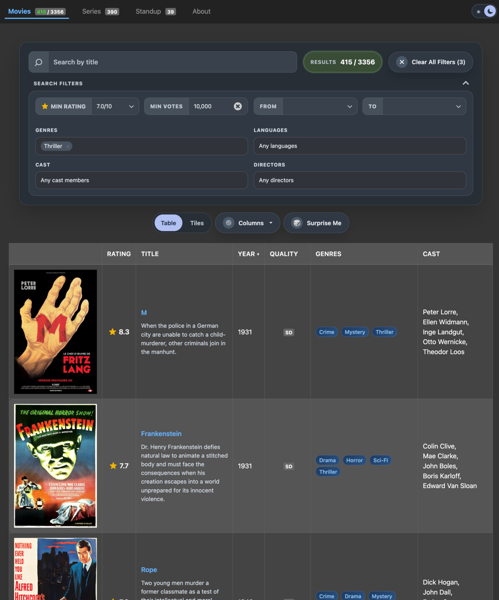
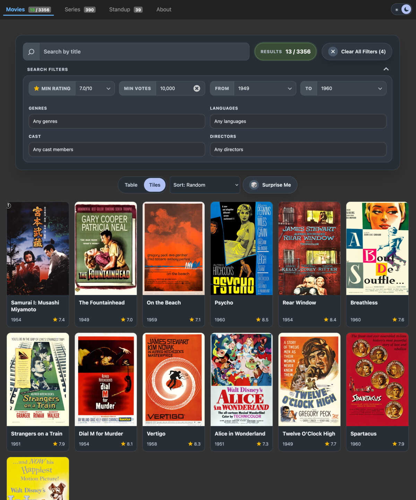
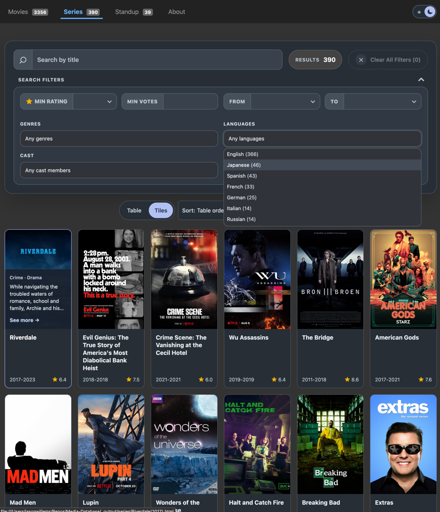
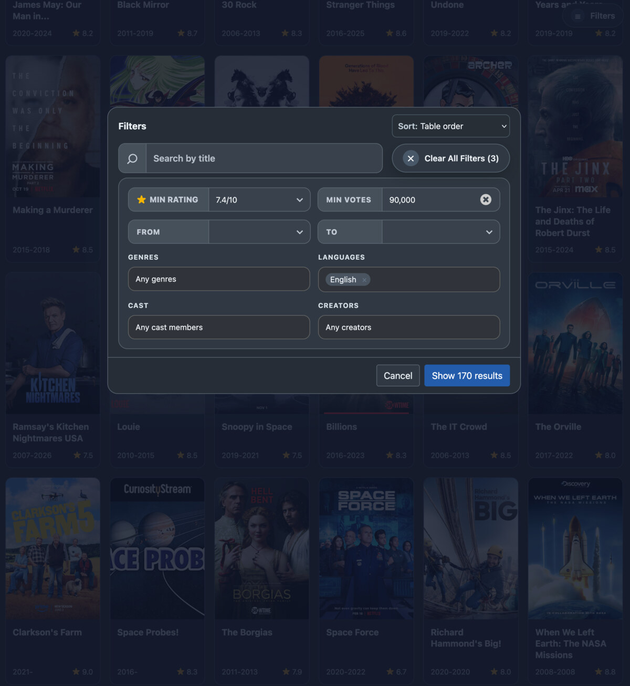
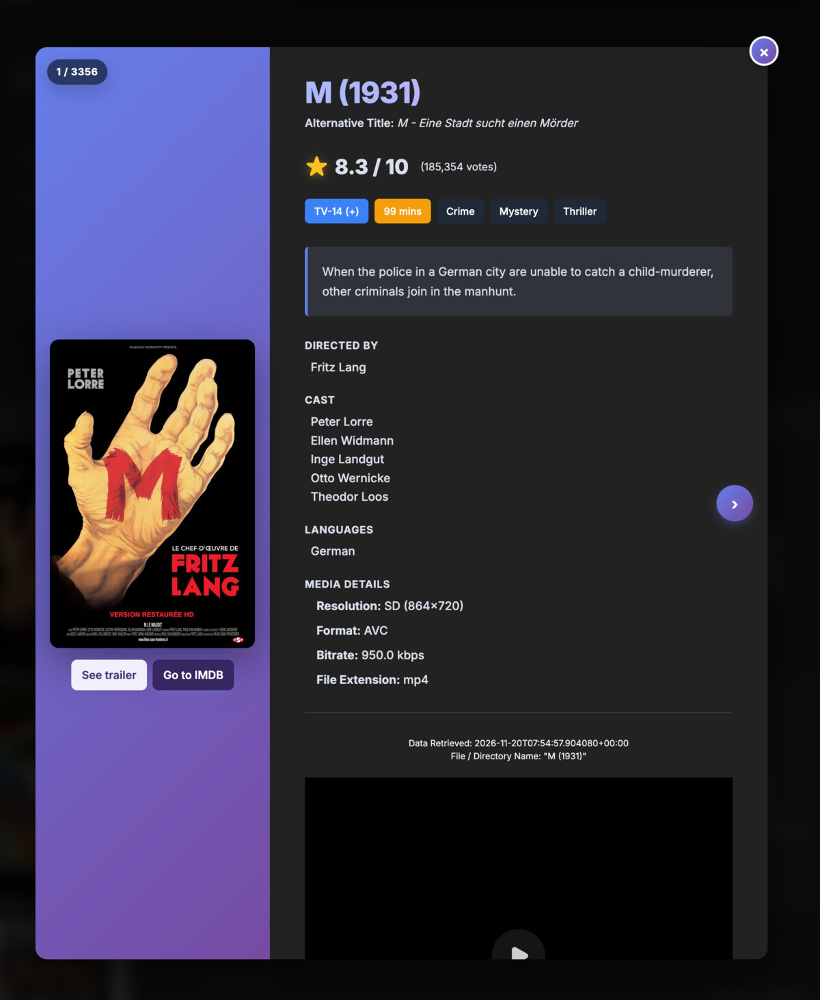

# Media Database

Media Database catalogs movies, TV series, and stand-up specials stored on your own drives. It scans your media folders, fetches IMDb metadata, and generates a local website where you can search, compare, and browse your collection.

## Quick start

You’ll need Python 3.10+, Git, Make, and a web browser. Indexing new titles and refreshing metadata require an internet connection to IMDb.

```bash
git clone https://github.com/at1as/Media-Database.git
cd Media-Database
make config
```

Edit `conf.json` and set each media category’s `location` to your library folder. Set `index_asset` to `false` for categories you don’t want to scan.

```bash
make run COUNT=1
```

This installs the dependencies in the local virtual environment, tries up to one new title per enabled category, and generates the site. Open `_output/index.html` in your browser. On macOS, use `open _output/index.html`.

Run `make run` for a normal indexing run, or `make` to see all available commands.

## Interface

- **Search and filter.** Combine a title search with minimum IMDb rating and vote count, years, genres, languages, cast, and directors or creators. Dropdown counts reflect the current matches.
- **Table and Tiles.** The table opens by default. Sort by a column or choose which columns to display. Tiles load as you scroll, support title, rating, and random sorting, and show a preview on hover. **Surprise Me** picks a title from your current results.
- **Floating filters.** Once the regular filters scroll out of view, **Filters** opens a panel with a match-count preview. Apply your changes to jump to the first match, or cancel to keep your place. The site remembers your view and theme across catalog pages. Dark mode is the default.
- **Title details.** Open a title to see its description, credits, IMDb link, and trailer when available. The detail view shows local media information and series episode lists, including resolution where it has been scanned. Compatible files can play in the browser.

Select any screenshot to enlarge it.

| Movie table | Movie tiles |
| --- | --- |
| <a href="docs/images/movie-table.jpg"></a> | <a href="docs/images/movie-tiles.jpg"></a> |

| Series filters and tile preview | Floating Filters panel |
| --- | --- |
| <a href="docs/images/series-tile-preview.jpg"></a> | <a href="docs/images/floating-filters.jpg"></a> |

### Title details

<a href="docs/images/movie-details.jpg"></a>

## Configuration and output

`make config` copies [`conf.json.template`](conf.json.template) and refuses to overwrite an existing configuration.

| Setting | What it controls |
| --- | --- |
| `assets` | Media folders, saved JSON paths, enabled categories, and scan limits |
| `exclude_files` | Files and directories the indexer skips |
| `include_extensions` | Video file extensions the indexer recognizes |
| `file_override` | IMDb IDs to use when a filename lookup picks the wrong title |
| `pause_time_sec` | Delay between IMDb lookups |
| `imdb_source` | Scraper implementation |

For each category, `max_assets` limits how many filesystem entries the indexer inspects and `max_assets_chunk` limits new lookup attempts in one run. The default saved catalogs are `_data/movie_data.json`, `_data/series_data.json`, and `_data/standup_data.json`. The generated pages are in `_output/`. Git ignores the local configuration, catalog data, and generated pages.

## Running and maintenance

Rebuild the site from the saved catalog without fetching new metadata.

```bash
make dryrun
```

`COUNT` caps new lookup attempts per enabled category, including misses. A lower `max_assets_chunk` still applies. `make run COUNT=0` skips new lookups.

Use a fixed cutoff to refresh older movie records in batches of up to 100.

```bash
make refresh-movie COUNT=100 UPDATED_BEFORE=2026-11-01 PRIORITY=missing
```

Reuse the same cutoff across batches. Only records checked or retrieved strictly before it are eligible. A date without a time means midnight UTC. `PRIORITY=missing` starts with gaps in metadata. `PRIORITY=oldest` orders by last retrieval or check. Movies default to oldest, while series and stand-up default to filling gaps. Use `make refresh-series` or `make refresh-standup` for the other categories.

Each cutoff run saves the time and outcome of each attempt, so unchanged, failed, and mismatched lookups don’t hold up future batches. Use a newer cutoff to retry them. Movie refreshes use the saved IMDb ID and preserve saved media paths, file details, and fuller metadata. `info_retrieved` advances when improved metadata is saved.

Run the test suite with `make test`.

Remove a saved record when you want the indexer to look up the title again.

```bash
python3 scripts/remove_entry.py --movie "<movie_title>" "<YYYY>"
python3 scripts/remove_entry.py --series "<series_title>" "<YYYY>"
```

The year is optional. If omitted, the first matching record is removed.

## Library layout

Movies can be individual files or directories containing the video and related assets.

```text
Inception (2010).mp4

Inception (2010)/
|-- Inception (2010).mp4
`-- Inception (2010).srt
```

Series should use a top-level directory named after the show and its start year, with episodes in season subdirectories.

```text
Firefly (2002)/
`-- Firefly Season 1/
    |-- Firefly S01E01.mp4
    |-- Firefly S01E01.srt
    |-- Firefly S01E02 The Train Job.mp4
    `-- Firefly S01E02 The Train Job.srt
```

## Related files

- [`run.py`](run.py) runs indexing, refreshes, and site builds.
- [`src/worker.py`](src/worker.py) handles indexing and catalog persistence.
- [`src/site_generator.py`](src/site_generator.py) renders the static pages.
- [`src/scrapers/imdb_suggest.py`](src/scrapers/imdb_suggest.py) implements the default IMDb lookup.
